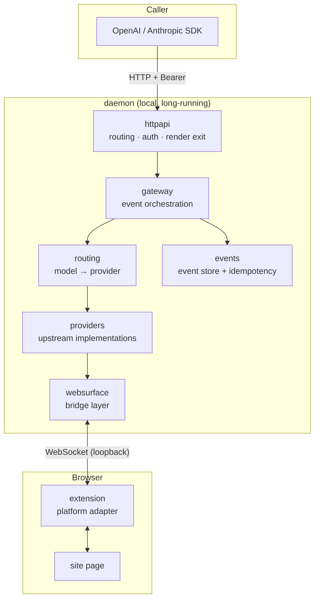

# Architecture

> Design and trade-offs only. Implementation, adapters and site-specific integration are out
> of scope for this repository — see [`DISCLOSURE.md`](DISCLOSURE.md).
> The P2P transport has its own document: [`P2P.md`](P2P.md).

## 1. The problem

Expose models that only exist **through a web UI** as a standards-compliant API: a client
using the OpenAI or Anthropic SDK sends a request and receives conforming JSON or SSE.

The difficulty is not the HTTP layer. It is three constraints holding at once:

1. **No usable interface.** The capability exists only behind a rendered page with a login
   session and a front-end state machine.
2. **The response is incremental rendering**, not a readable response body. Producing a token
   stream means intercepting blocks as they render.
3. **The same session is operated concurrently.** Multiple client requests can land on the
   same page and contaminate each other's input box and generation state.

## 2. Design goals

| Goal | Trade-off taken |
|---|---|
| Minimise the detectable surface | Real browser web session; no APK, adb or scrcpy channel |
| Reuse existing sessions | Reuse the user's browser profile; the product holds no credentials |
| One auditable event stream | Do not assemble SSE directly — normalise into events first, then render |
| Adding a platform must not touch the engine | Site differences confined to exactly two boundaries |

The last one is the expensive decision: it keeps the first three from degrading linearly
with the number of platforms.

## 3. Three tiers



Three boundaries carry all the design weight:

- **Caller ↔ daemon** — standard HTTP, Bearer auth. Control and data planes share a port, but
  the local admin surface uses an auth-exempt path and **accepts loopback origins only**.
- **Daemon ↔ extension** — a bidirectional long-lived WebSocket. The daemon issues commands,
  the extension reports render events. This is the boundary that turns "something happened in
  a browser" into something the daemon can orchestrate.
- **Extension ↔ site** — the only contact surface with a third party. All site knowledge is
  confined here plus the daemon-side policy registry, and must not rise into the engine.

## 4. Event stream contract

```
accept → route → dispatch → (render_event)* → finalize
                                    │
                                    ├─ cancel (client disconnect / explicit stop)
                                    └─ retry  (failure judged recoverable)
```

Four properties:

1. **Unidirectional.** Events flow from provider to render; never back.
2. **Cancellable.** A client disconnect must propagate into stopping generation on the site,
   otherwise an idle page session is left behind. This is its own layer (session lifecycle),
   not something an HTTP close handles for free.
3. **Retryable.** Only failures judged to leave "no non-reusable side effect" may retry, and
   the judgement is made from the event stream position, not from the exception type.
4. **Idempotent.** Requests carry idempotency keys; a resubmission returns the same result
   without driving the page again.

Two consumers, one stream:

| Exit | Form |
|---|---|
| `/v1/chat/completions`, `/v1/messages` non-streaming | single JSON after aggregation |
| same, streaming | one SSE chunk per event |

The benefit is that adding an output format never touches a provider. The cost is that full
event state must be retained, and both memory and storage pay for it.

## 5. Extension points

One platform = **two registrations, engine untouched**:

| Location | Responsibility | Change frequency |
|---|---|---|
| Daemon-side policy | model/tier mapping, behaviour switches, capability declaration | once per platform |
| Extension-side adapter | locate input, inject, detect end of generation | once per platform |
| Shared engine | orchestration, streaming adaptation, error classification | never |

Capability declaration means **explicit failure**: unsupported attachments are declared and
rejected at the request level instead of being silently dropped mid-render. "Fail loudly,
never degrade silently" runs through the whole system — a collection pipeline that loses data
quietly is more expensive than one that errors.

## 6. Failure modes that were actually paid for

| Failure | Root cause | Design correction |
|---|---|---|
| Site keeps generating after the client stops | Lifecycle was an interface with no implementation; cleanup was dead code | Stop became an explicit command crossing the bridge, not a side effect of disconnect |
| Page reopened in a loop | Recovery had no backoff; the same platform reloaded repeatedly | Exponential backoff on consecutive ineffective recovery, one-shot alert |
| Periodic kick-and-reconnect on long connections | Keepalive racing the site's own heartbeat | Observe first: quantify the kick rate before choosing a policy |
| First tunnelled packet lost | Bytes already read into a buffer during handshake were discarded | Preserve handshake-buffered bytes instead of re-reading |

The common shape: **the success path was right and the failure path was unwritten.** This
class of defect never turns a test red; it quietly degrades production. Which is why the event
stream has to be auditable — otherwise you cannot even know degradation happened.

## 7. The road not taken

App automation (adb plus a device farm) bypasses the web state machine by operating the UI
directly. It leaves a larger detectable surface — device characteristics, injection framework,
timing signatures of coordinate taps — and scaling requires real hardware. This project takes
the browser path to minimise that surface, at the cost of having to coexist with a front-end
state machine.

The choice was validated in the opposite direction in a different project (payment gateway
device orchestration): there the device **is** the business object, so adb is correct; here the
device is only a channel, so the browser is correct. **The same technology gets opposite
answers under different constraints**, and the deciding question is which complexity cannot be
removed.
