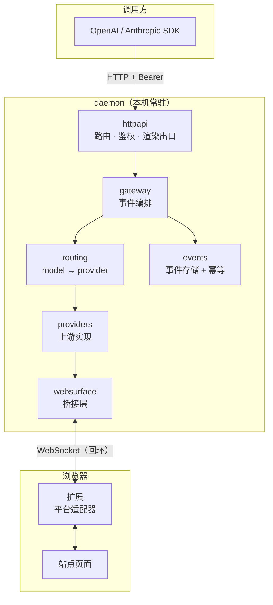

# Symbiqo 架构

> 本文只描述结构与取舍。实现、适配器细节与站点接入方法不在公开范围内，
> 边界见 [`DISCLOSURE.md`](DISCLOSURE.zh-CN.md)。

## 1. 问题

把若干**只能通过网页版交互**的模型，包装成一个标准 API：客户端用 OpenAI SDK 或
Anthropic SDK 发请求，拿到符合规范的 JSON 或 SSE。

难点不在 HTTP 层，而在这三条约束同时成立时：

1. **没有可用接口**。目标能力只存在于有界面、有登录态、有前端状态机的网页里。
2. **响应是页面内的增量渲染**，不是一次可读的响应体。要变成 token 流，必须在渲染过程中逐块截取。
3. **同一会话会被并发操作**。多个客户端请求可能落到同一个页面，互相污染输入框与生成状态。

## 2. 设计目标

| 目标 | 取舍 |
|---|---|
| 可检测面最小 | 走真实浏览器 Web 会话，不引入 APK / adb / scrcpy 这类可被检测的通道 |
| 登录态复用 | 复用用户已有浏览器 profile，产品本身不保管凭据 |
| 单条事件流可审计 | 不直接拼 SSE，先归一成事件再渲染，取消/重试/幂等都有轨迹 |
| 新增平台不动引擎 | 站点差异收敛在**两个**边界：daemon 侧策略与扩展侧适配器 |

最后一条是这套设计里最贵的决定：它让前三个目标不至于随平台数量线性劣化。

## 3. 三层拓扑



三条边界值得单独说明：

- **客户端 ↔ daemon**：标准 HTTP，鉴权是 Bearer。控制面与数据面共用端口，
  但本地管理面走豁免路径且**只接受回环来源**。
- **daemon ↔ 扩展**：长连接 WebSocket，双向。daemon 下发指令，扩展回报渲染事件。
  这条边界是关键：它把「浏览器里发生了什么」变成 daemon 侧可编排的事件。
- **扩展 ↔ 站点**：产品与第三方之间唯一的接触面。所有与站点相关的知识都限制在这里
  （以及 daemon 侧的策略登记），不得上浮到引擎。

## 4. 事件流契约

一条请求的生命周期：

```
accept → route → dispatch → (render_event)* → finalize
                                    │
                                    ├─ cancel（客户端断开 / 主动停止）
                                    └─ retry（可判定的失败）
```

契约的四条性质：

1. **单向**。事件只从 provider 流向 render，不允许回写。
2. **可取消**。客户端断开必须传导到站点侧停止生成，否则会留下空转的页面会话。
   这一条在实现上是独立的一层（会话生命周期），不是靠 HTTP 连接关闭自动带走的。
3. **可重试**。只有被判定为「未产生不可复用副作用」的失败才允许重试，
   判定依据是事件流的位置，而不是异常类型。
4. **幂等**。请求携带幂等键，重复提交返回同一结果而不重复驱动页面。

渲染出口有两个消费者，吃同一条事件流：

| 出口 | 形态 |
|---|---|
| `/v1/chat/completions`、`/v1/messages` 非流式 | 聚合完成后一次性 JSON |
| 同上的流式 | SSE chunk 逐条产出 |

好处是新增一种输出格式不需要碰 provider；代价是中间必须维护完整事件状态，
内存与存储都要为它让路。

## 5. 可扩展点

新增一个平台 = **两处登记，引擎不动**：

| 位置 | 职责 | 变更频率 |
|---|---|---|
| daemon 侧策略登记 | 模型与档位映射、行为开关、能力声明 | 每个平台一次 |
| 扩展侧适配器 | 定位输入、注入、判定生成结束 | 每个平台一次 |
| 共享引擎 | 编排、流式适配、错误分类 | 不变 |

能力声明的意义是**显式失败**：某个平台不支持附件，就声明出来并在请求侧拒掉，
而不是在渲染中途静默丢图。这类「宁可报错不静默降级」的取向贯穿全系统。

## 6. 失败模式与代价

生产上真实付出过代价的地方，按设计缺陷归类：

| 失败形态 | 根因 | 设计上的修正 |
|---|---|---|
| 客户端停止后站点仍在生成 | 生命周期只有接口没有实现，清理逻辑成了死代码 | 把「停止」做成显式指令穿过桥，而不是依赖连接断开 |
| 页面被反复重开的死循环 | 恢复策略没有退避，同一个平台被连续重载 | 连续无效恢复指数退避 + 一次性告警 |
| 长连接周期性被踢再重连 | 保活与站点自身心跳竞争 | 观测先行：先量化踢出频率，再定策略 |
| 隧道首包丢失 | 握手阶段读进缓冲区的字节被丢弃 | 保留握手期已读字节，不重读 |

共同点：**都是「成功路径正确、失败路径没人写」**。这类缺陷不会让测试变红，
只会让线上悄悄退化。所以事件流必须可审计——否则连「退化发生了」都不知道。

## 7. 另一条路，以及为什么不走

App 自动化（adb + 设备农场）能绕开网页状态机，直接操作界面。它的问题是可检测面更大：
设备指纹、注入框架、坐标点击的时序特征都留下痕迹，且横向扩展要真实设备。
本项目选择浏览器 Web 会话，是把「可检测面」压到最小，代价是必须与前端状态机共存。

这个取舍在另一个项目（支付网关的设备池编排）里做过反向验证——那里设备是业务对象本身，
所以 adb 是正解；这里设备只是通道，所以浏览器是正解。**同一技术在不同约束下答案相反**，
判断依据是「谁是不可消除的复杂度」。
