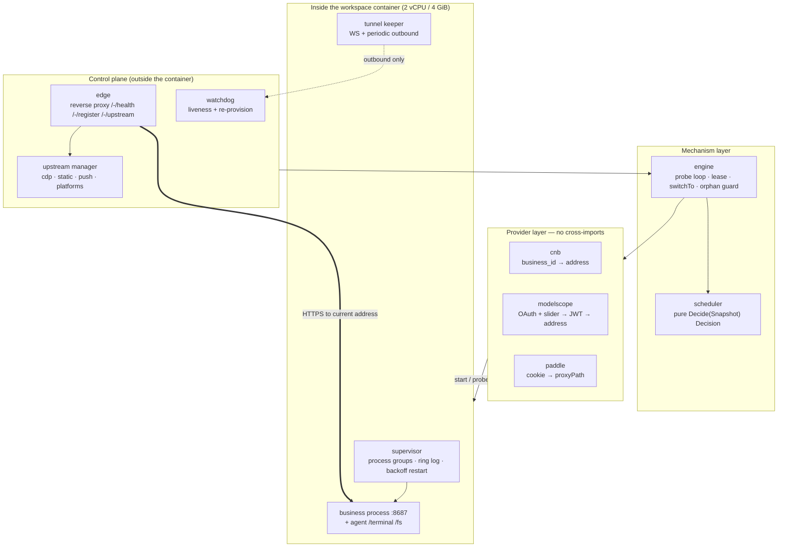

# boxproxy — Runtime Substrate for Disposable Containers

> **Status: control plane implemented and in use; P2P bridging not implemented.**
> This document describes a sibling system to Symbiqo. It supplies the runtime that Symbiqo's
> collection layer executes in, and it is where the per-environment ingress problem lives.

The premise is uncomfortable: development containers on hosted platforms are *not* VPSes. The
difference is not performance, it is lifecycle and entitlements. A container that is recycled
every 18 hours, has no persistent disk, no inbound TCP, and a hostname that changes on every
rebuild cannot be treated as a server. It can still be treated as a **worker** — but only if
something outside it owns identity, address, and recovery.

boxproxy is that something.

## 0. What it actually solves

Three platforms, each with a different ingress shape and a different credential channel:

| Platform | Endpoint shape | Credential channel |
|---|---|---|
| CNB workspace | `https://<business_id>-8687.cnb.run/` | access token (Bearer) for lifecycle; browser session for token/key management |
| ModelScope DSW | `https://<num>-proxy-8687.dsw-gateway-…aliyun.com/` | OAuth + slider, then a JWT |
| Paddle AI Studio | platform-issued `proxyPath`, no port in the URL | cookie |

The business port is a single value — **8687** — and it is simultaneously the listen port and
the port label inside the address. Three platforms, three address assembly rules, one port.

## 1. Architecture

Every arrow into the container goes one way except the tunnel, which is the container dialling
out. The container is never dialled *in* — it has no inbound TCP at all (§5).

### 1.1 The layer contract, and why it is a hard boundary

| Layer | Responsibility | Forbidden |
|---|---|---|
| `provider` | one platform: start, probe, hand back an address | importing another provider; retry policy |
| `engine` | mechanism: probe loop, lease, switch, orphan-billing guard | importing a concrete platform; deciding *whether* to switch |
| `scheduler` | policy: pure `Decide(Snapshot) Decision` | touching the network or the clock (time is a parameter) |

`Instance` exposes exactly three methods — `ID / Healthy / Endpoint`. An earlier `Exec` was
deleted: a method with zero call sites that forced every provider to implement its own private
exec channel is pure liability. Execution goes through the container-side agent's `/terminal`,
which is a channel we control.

The boundary is enforced by tests, and the test is behavioural rather than aspirational:
**delete any one provider directory and the rest of the tree still compiles.**

### 1.2 Single source of truth for the port

The port is injected once through `wire.Options.ServicePort`, read from `cfg.Listen`. Providers
hold **no** port constant. This is a bug that cannot be caught at compile time: three providers
each hard-coded 8092 while the container listened on 8687, so all three assembled addresses were
syntactically valid and functionally dead. Nothing failed until an external request did.

The generalisation is worth more than the fix: **an address assembled from more than one source
is an address that will eventually be wrong.**

## 2. Keepalive: three platforms collapse into two behaviours

The naive model is "keep the page open". Measurement killed it: `/healthz`'s `expired` field has
no relation to reclamation (verified by an 18-minute experiment), and a browser does not need to
be resident at all. What actually keeps a container alive is **one sustained tunnel plus
periodic outbound traffic**.

The three platforms reduce to two session shapes:

| | CNB | ModelScope DSW / Paddle AI Studio |
|---|---|---|
| Server | code-server | Jupyter Server |
| After connect | pushes a frame every 5 s | speaks only when there is output |
| Death criterion | how long since the last frame | one heartbeat round-trip timeout |
| Outbound needed | standard WS ping | WS ping **and** `set_size` |

The second column's two-action requirement is the non-obvious part, and both halves are
load-bearing:

- **WS ping is answered but does not advance `last_activity`.** Tornado replies `pong` at the
  protocol layer and never reaches a handler. Ping alone yields "connection alive, platform
  considers you idle".
- **`set_size` advances activity but returns nothing.** It alone yields "activity recorded, but
  the write may have gone into a dead socket".

They are not redundant; they cover different failure modes.

Layering follows one question — *would this look different on another platform?* If yes, it goes
down into `Session` (`cnb.go` / `jupyter.go` / `modelscope.go` / `paddle.go`); if no, it stays in
`Keeper` (backoff, counters, error reporting).

Three assumptions were discarded while implementing this, all worth recording because each one
was a plausible design input:

| Assumption | Reality |
|---|---|
| the tunnel URL's `reconnectionToken` is validated | not validated — random or empty still gets 101, so no need to scrape code-server's JS state |
| the workbench version must be discovered dynamically | it is in the page HTML; one cookie-authenticated GET |
| keepalive needs a real browser navigating pages | one process: one WS, a ping every 30 s, self-healing |

The one action that remains genuinely necessary is the *first* page entry — the platform requires
the VS Code page to have been visited within 10 minutes of creation. That is a one-shot, not a
keepalive duty.

## 3. Self-healing, three layers

1. **Process** — supervisor restarts with exponential backoff (1 s → 30 s) inside a process
   group, so a crash does not leak the port.
2. **Workspace** — a scheduled probe inside the platform every 5 minutes, plus an external
   watchdog that re-provisions through the API. The external half is mandatory: the platform
   suspends scheduled pipelines on repositories with no recent commits, so a watchdog living
   only inside the platform will stop watching exactly when it is needed.
3. **Ingress** — the tunnel client reconnects on its own; the domain and port do not change.

Health accounting counts only `restart=always` processes. A one-shot script exiting successfully
must not turn `/health` degraded — otherwise the signal is noise and stops being read.

## 4. Persistence: the artifact registry is the disk

The container has no persistent volume, but the Docker artifact registry is durable. `snapshot`
takes `tar` → `FROM scratch` image → `push`, and restores by unpacking into `/workspace`. The
correct trigger points are the platform's open/close stages, not a human remembering to click.

This changes the design constraint from "state cannot persist" to "state must be snapshotted at
defined boundaries". Anything mutated between a snapshot and a recycle is still lost, so the
rule is: **state that matters must be either external or reconstructible, never merely local.**

## 5. The six ceilings

Recorded once so the experiments are not repeated. Each was measured, not assumed.

| # | Capability | Verdict |
|---|---|---|
| 1 | arbitrary TCP inbound | no — only HTTP/HTTPS is forwarded |
| 2 | UDP inbound | no |
| 3 | UDP hole punching | no — multi-egress + symmetric NAT, no IPv6 |
| 4 | stable address | no — the instance prefix changes on every rebuild |
| 5 | TUN / transparent proxy | no — no `/dev/net/tun`, no `CAP_NET_ADMIN` |
| 6 | SLA | no — 18-hour ceiling plus a forced recycle window |

The substrate therefore promises exactly one thing: **a native, transparent, bidirectional
channel with rebuild-on-break and address governance.** Application-layer protocol adaptation is
not this layer's job.

Two of these deserve emphasis because they are routinely misread:

**Inbound is L7, not L4.** Every `*.cnb.run` hostname — including ones for instances that do not
exist, and including `-3001` / `-8686` / `-4001` port labels — resolves to the same pair of edge
IPs. Ports 4001, 7000, 8686 are closed or filtered; only 80/443 are open; TLS terminates at the
edge with a wildcard certificate. The port number is a **hostname label** that an HTTP gateway
parses and forwards. There is no public host, only a public edge. That is also why VNC works
remotely without 5901 being open: noVNC is VNC-over-WebSocket, served by websockify on 8686.

**Inbound requires binding `0.0.0.0`.** The platform dials back from the container network
address, so a service on `127.0.0.1:8687` yields `status=500 / dial tcp 172.17.0.56:8687:
connection refused` — and the error page then shows that container IP to whoever asked.

## 6. What is not implemented

**P2P bridging of per-environment container ingress endpoints is not built.** There is no
libp2p, no relay client, no hole punching in this codebase. It reaches working containers through
the platform's own ingress and keeps them alive through an outbound WS tunnel; those are two
different mechanisms and neither is peer-to-peer.

This is a deliberate ordering, not an oversight, and the reason is architectural:

> boxproxy's ingress has **no caller identity**. The address *is* the credential — anyone holding
> `<business_id>-8687.cnb.run` can reach the service, with no token, no request signature, and no
> way to revoke short of rebuilding the instance. A peer-to-peer bridge would replace
> "unguessable URL" with "any peer that completes a handshake", which is **strictly weaker**.

So the bridge is blocked on authentication, not on transport. The design for that is in
[`INGRESS-AUTH.md`](INGRESS-AUTH.md), and it is explicitly a design document — the admission
control it describes does not exist yet either.

The honest summary of the ordering: the transport layer is the part we know how to build. The
part we do not yet know how to build correctly is deciding *who is allowed through it*, per
environment, with per-environment keys and revocable grants. Building the pipe first would mean
shipping a second unauthenticated door onto the same container.

## 7. Scale and shape

18,767 lines of Go outside tests, 29 test files, 22 internal packages. The largest are `tunnel`
(2.8k), `provision` (1.7k), `providers` (1.4k), `agent` (1.1k), `provider` (1.0k). The binary
dispatches on subcommand: `edge`, `workspace`, `snapshot`, `deploy`, `provision`, `push`,
`keepalive`, `watchdog`, `doctor`, `address`, `install`, `exec`, `get`, `put`.

The distribution is the point: the interesting code is not in one big command but in a
mechanism layer that does not know which platform it is driving. Adding a fourth platform means
adding one directory and one registration, not editing a switch statement.
