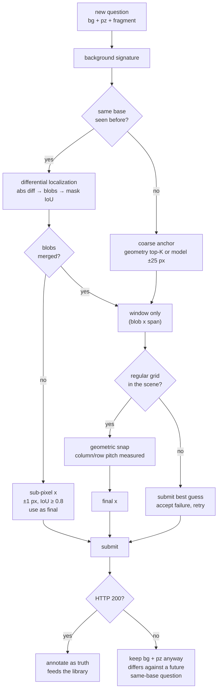

# CAPTCHA — Verifying an Answer You Cannot Read

> **Status: research notes, not a shipped capability.**
> The solver in production runs at a measured failure rate; no dedicated model has been trained.
> This document records what was measured, what the measurements killed, and what the planned
> small model would have to satisfy before it is worth building.

The task is a slider puzzle: a fragment is cut out of a background photo and the gap is filled
by generative inpainting; the user drags the fragment back. The question this document answers
is narrow and unforgiving — **how do you know an answer is correct?**

Everything else depends on it. A solver with no ground truth cannot tell whether a change made
it better, cannot compare two criteria, and cannot report a success rate that means anything.

## 0. Four findings, in the order they cost us time

1. **The answer cannot be reliably read off the image.** The gap is inpainted, and the fill is
   as sharp as the real object. Measured Laplacian 95th percentile inside the mask: real
   fragment **64.5**, inpainted region **57.6** — under 11% apart, with specular highlights and
   texture intact. "The filled area is blurrier" is false.
2. **The only reliable truth source is a human drag.** After a person drags, `puzzle.style.left`
   *is* the answer (the fragment image and the canvas are 1:1 in pixels), and HTTP 200 confirms
   the server accepted it. So the only path that produces truth is *human solves, program
   annotates*.
3. **The algorithm's correct role is candidate generation, not judging.** It shrinks a 0–260 px
   search space to 3–5 candidates a person can pick from at a glance. When it picks the winner
   itself, it is wrong too often to trust — and on clean data it is wrong almost always (§3).
4. **Failure rate is a normal cost, not a bug.** One wrong drag → 403 → the server serves a new
   puzzle. The next attempt is a different question; there is no answer to memorise. Design for
   retries, not for 100%.

## 1. Why the image does not contain the answer

Three independent failure modes, each measured:

| Failure mode | Evidence |
|---|---|
| Inpainted gap is as sharp as the real object | 64.5 vs 57.6 Laplacian p95, <11% apart |
| Naturally flat regions impersonate a gap | x=177 false positive: dark blue wall, genuinely low texture |
| Fragment is not rectangular | one fragment 25 px wide at its widest, varying 4–25 px row by row |

The third one compounds the first two: matching on "widest row" mis-locates the gap, which then
locks onto the wrong flat stretch. A single scalar width criterion cannot survive a shape whose
width varies by 6× down its own height.

### 1.1 Ranking on a known-truth sample (truth x=225)

| Criterion | Top-1 | Top-2 | Top-3 |
|---|---|---|---|
| Geometry ring (contour edge minus interior flatness) | 257 (off by 32) | **227 (hit, ±3)** | 193 |
| In-band texture flatness | 115 | 114 | 113 (all wrong) |

The geometry ring carries signal but cannot rank; texture flatness collapses outright.
**What is usable is "the truth is in the Top-K", not "Top-1 equals the truth".**

## 2. Where the truth comes from

The server never returns the answer. It returns 200 or 403. So the answer has to be captured
from the client side at the moment of a successful drag:

- `puzzle.style.left` after a human drag, in pixels, 1:1 with the canvas.
- Paired with `bg.png` + `pz.png` saved at question time.
- Annotated as truth only on HTTP 200.

A recorder script automates the capture and the annotation; a human supplies the drag. That is
the whole truth pipeline. It does not scale well, which is exactly why §4 matters.

## 3. The measurement baseline was polluted — and this invalidated a week of numbers

This is the most expensive finding in the document.

Samples that failed with 403 were being recorded with the *solver's own submission* as their
"truth". Every statistic computed on that library was therefore **the solver grading its own
homework**. The tell was a holdout set built with an independent method (§4): on four questions
the previous solver had failed, it scored **0/4**, with errors of 15, 37, 73 and 75 px.

So the correct statement is not "the model is worse than the geometry" — it is **both are close
to zero on uncontaminated data**:

| Criterion | Clean holdout (n=4, ±12 px) |
|---|---|
| Pure geometry | 0/4 |
| Multimodal model | 0–1/4 |

Two rules came out of this and they are now binding:

- **Any model metric must be multi-sampled. A single run is not a result.** Same input, spread
  of 185 px across runs was observed.
- **Aggregate with the median, not the mode.** With three votes split three ways, the mode
  degenerates to "pick the smallest", which is consistently the most wrong end.
- **No conclusion at n < 20.**

## 4. Answer tolerance: under 15 px

One sample in the whole library had all three of: known truth (222), known submission (237.4),
known rejection (403). That single triple bounds the tolerance from above:

> **Tolerance < 15 px.** With ±2 px uncertainty in the independent method itself, the real
> figure is probably around ±10 px.

Everything measured with a looser window is measuring a *region*, not an answer. Three earlier
results (17/17 region coverage, 65%, a ±35 px window) all used windows wide enough to hide the
error. **All evaluation now uses ±12 px as the "correct" threshold.**

This number drives the model design in §6: ±12 px over a 0–260 px range is a **4.6% error
requirement**. That is not a regression problem. Treating it as one is why the direct-coordinate
approach scored 0/4 with 26–40 px errors.

## 5. The one deterministic path: differential localization

The site reuses background photos. This was a guess, then a measurement.

**Base-image reuse is real, and denser than expected.** Across 53 background images, pairwise
16×16 grayscale normalised correlation plus 32×32 colour MAE:

| Metric | Result |
|---|---|
| Pairs with correlation ≥ 0.9 | 17 |
| Largest same-base group | 4 images / 3 question IDs |
| Groups containing ≥ 2 *distinct* fragments | 5 groups, 13 samples, 12 question IDs |

Same-base colour MAE is **0.0027–0.0035**; different scenes are **86–98**. Three orders of
magnitude apart. There is no grey zone, so the grouping is not a threshold judgement.

**This makes the answer computable without a model.** If two questions share a base image, the
only difference between them is their respective gaps:

```
diff = |bgA - bgB|.max(channel) > 25
```

On a verified pair, that yields exactly two blobs — and the blob shape *is* the alpha outline of
the removed fragment, so `(y band, width, height)` identifies which blob belongs to which
question. Sliding the fragment mask inside its blob and taking the IoU maximum gives a
sub-pixel x.

Verification against known truth (the 4 pairs that could be differenced out of 17):

| Target | Truth | Read | Error | IoU |
|---|---|---|---|---|
| `0af0673bb338` | 239.2 | 239 | −0.2 | 0.96 |
| `172288333a34` | 212.4 | 211 | −1.4 | 0.80 |
| `f6a562fef26e` | 193.7 | 194 | +0.3 | 0.92 |
| `9b4275b454a3` | 235.6 | 219 | −16.6 | 0.96 — blobs merged |

**3/4 pass. At IoU ≥ 0.8 the value can be used directly as final.**

### 5.1 Three properties that make it the right foundation

1. **It does not need truth.** Two questions on the same base, *both unknown*, can be differenced
   against each other and solved simultaneously. A cached-answer library requires a prior correct
   solve; this requires only that the base image has been seen once.
2. **Merged blobs are the failure mode, and it is detectable.** When two gaps sit close — 239.2
   and 235.6 are 3.6 px apart — the connected components fuse into one and the joint solve
   attributes residual pixels to the wrong mask. In that case it degrades to a **window** (the
   blob's x span) for a model or a geometric criterion to close, and must never be used as a
   final value. This discipline is not optional: the same sample read −0.2 in one test and −16.6
   in another.
3. **Cost is effectively zero.** One subtraction and two mask slides. No network, no model, no
   trial and error.

### 5.2 Why this compounds

25% of the current 53 images already sit in multi-member groups. Every additional question
captured — **including ones answered wrongly** — raises the probability that a future question
hits a known base. Capture only needs `bg.png + pz.png`, not a success.

That is the only path in this project whose cost per correct answer *falls* as the library
grows. It is therefore first in the queue, ahead of any model work.

### 5.3 Decision flow, per question

The pipeline below is the intended shape, not the current one: only the differential branch
exists as a standalone script, and the other three branches are criteria and models evaluated
offline.



Two properties of this flow matter more than the individual steps:

- **The cheap deterministic branch is checked first.** A new question costs one array subtraction
  before it costs a model call, and the branch that answers most accurately (sub-pixel, ±1 px) is
  also the cheapest one.
- **A failed answer is still an asset.** Saving `bg + pz` on a 403 costs nothing and creates a
  future differencing partner. This is why the capture path must not be conditional on success.

## 6. Where models actually fail — it is not resolution

The natural explanation for "the model is off by 20 px" is that it cannot see well enough. A
controlled experiment kills that explanation.

Hold the true position fixed, offset the alternative by `gap`, ask for a pairwise choice, and
sweep `gap` from 90 px down to 8 px. Same model, same prompt, only the stimulus separation
changes. 3 votes per level, left and right randomised to cancel position bias, 36 calls total:

| gap | Correct |
|---|---|
| 90 px | 83% |
| 60 px | 100% |
| 40 px | 67% |
| 25 px | 83% |
| 15 px | 67% |
| 8 px | 83% |
| **total** | **30/36 = 83.3%** |

**The curve is flat.** If this were a resolution problem, accuracy would fall as `gap` shrinks.
At 8 px it is as accurate as at 90 px. The model can see the difference — at 6× magnification,
8 px is roughly 48 display pixels, visible to the naked eye.

So the failure is **a probabilistic miss at 83.3% per single vote**, not a systematic misreading
(which would bias consistently by one column pitch) and not a visibility limit. It also matches
the observed 185 px spread on identical input.

### 6.1 What that implies for ensembling

Binomial projection from the measured single-vote rate (a projection, not a measurement):

| Votes | Per-step accuracy |
|---|---|
| 1 | 83.3% |
| 3 | 92.6% |
| 5 | 96.4% |
| 7 | 98.2% |

92.6% per step looks adequate until the steps are chained: a workflow of k independent decisions
compounds, so a five-step chain at 92.6% lands near 68%. **The amplifier is the chain, not the
single step** — which is an argument for fewer, wider decisions rather than more, finer ones.

### 6.2 Ranking of interaction forms (all measured)

| Method | Result | Verdict |
|---|---|---|
| Ask for an absolute coordinate | 0/4, errors 26–40 px, 2 empty responses | unusable |
| Single image, 19-cell sliding grid, score each cell | best 2/4; parameters changed → collapse; repeated 12/12 wrong, round one always picked the leftmost cell | not reproducible; serial anchoring bias |
| **AB pairwise (truth vs. offset ≥ 25 px)** | **11/12 = 92%** | the only reliable form |

The middle row is the important negative result. A grid presented in one image induces a
*serial anchoring bias*: the model answers relative to the first cell it sees, not relative to
the content. Any interface that puts candidates in a single ordered frame inherits this.

## 7. The planned small model — and the criteria it must satisfy

**Not trained. No weights exist.** The library target is 30–50 labelled questions; the clean
independent-truth set is currently 4. What follows is the specification a small model would have
to meet, derived from what the experiments above ruled out.

### 7.1 The output head is a decision, not a coordinate

The tolerance is ±12 px on a 0–260 px range — 4.6%. A regression head at that precision, on a
signal where a strong general model jitters 15–25 px, is the wrong shape. The measured forms
say the same thing: absolute coordinates 0/4, grid scan not reproducible, pairwise choice 92%.

So the model's job is to answer, for a *given* candidate region, **"is the gap here?"** — a
binary or few-class decision over a small candidate set produced by something cheap (geometry,
or differential localization, or a coarse ±25 px anchor). The final x comes from a
deterministic refinement inside the chosen window, not from the model.

### 7.2 The supervision signal is the hard part

The decisive design constraint is what the negative class contains:

> **The criterion must be "is something missing here", never "does this look right".**

Three criteria built on "looks right" were implemented and all failed — column scoring,
inner-minus-outer ring energy, darkness peaks. The reason is structural: a fragment pasted onto
the *real object it was cut from* scores as highly as the correct placement, because the pixels
match. Any "similarity" loss therefore has a global optimum at the wrong place.

For a trainable model this means the negative class must explicitly include the neighbouring
real object, and the label must describe *absence*, not appearance. A dataset built by sampling
random offsets will teach the model exactly the wrong feature.

### 7.3 The label factory comes before the model

If labels come only from human drags, the library grows at human speed and the model is never
worth training. The differential path (§5) is what breaks that dependency:

```
same base image, two questions
   → difference → two blobs → mask IoU → sub-pixel x for BOTH
   → labels with no human, no model, no trial and error
```

So the correct build order is: **diffusion of truth via differential localization first, model
second.** The model is downstream of the label factory, not a parallel bet. Building it first
would mean training on 4 samples and calling it a result.

### 7.4 Gate before spending on it

| Gate | Requirement |
|---|---|
| Library size | ≥ 20 questions with independent truth (currently 4) |
| Metric | ±12 px, multi-sampled, median-aggregated, n ≥ 20 |
| Incumbent to beat | differential localization where a same-base partner exists (§5) |
| External baseline | `FUSED` (forensic manipulation detector, CPU-runnable, torch + ConvNeXt, 2–3 GB) — criterion: does its mask centre land within ±5 px? |

The FUSED gate is deliberately brutal and deliberately cheap. If a purpose-built forensic model
cannot localise the inpainted region, then the region genuinely does not carry recoverable
evidence, and the remaining options are human, a commercial solving service, or model scoring —
in that order of cost. Knowing that early is worth more than a partially-trained model.

### 7.5 Where the model is genuinely irreplaceable

One case: **a base image never seen before, with a fragment whose content is ambiguous** — a
small, low-contrast fragment over a busy texture. There is no partner image to difference
against, and the geometric criteria have no regularity to snap to. That is the residual set the
model exists for, and it is smaller than it first appears: 25% of current images already have a
differencing partner, and that fraction rises monotonically.

## 8. What is not built

- **No trained model.** No weights, no dataset, no training run.
- **No library.** `data/captcha-truth/` holds recorder logs only. First target: 30–50 questions.
- **No Go implementation.** Algorithms are Python experiment scripts (~40 of them); the intended
  destination is `internal/captcha` for criteria and `internal/driver` for CDP drag and capture.
- **Differential localization is not wired into the live path.** It works as a standalone script
  with `--clusters / --eval / --target`; the remaining work is a background-signature lookup
  before the model or geometry runs at all.
- **Same-question retry is unverified.** Whether the captcha layer permits a second attempt on
  the same question (as opposed to a new question after a business 403) is still an open
  question with a known 2-minute experiment; it decides between an 11-step deterministic scan
  and the human-annotation path.

## 9. Exclusions

- Do not chase 100% per attempt. Each question is unique and the signal is weak; retry is part
  of the design.
- Do not tune parameters below 10 library entries. The result is overfitting by construction.
- Do not read consecutive 403s as rate limiting. The response body says the check failed —
  the answer was wrong.
- Do not pre-refresh to cherry-pick an easy image. Refreshing produces no drag trajectory;
  N refreshes for one drag is a clean machine fingerprint.
- This document does not describe how to reach the target, which endpoints exist, or how a
  session is established. Per `DISCLOSURE.md`, that is out of scope for a public repository.
