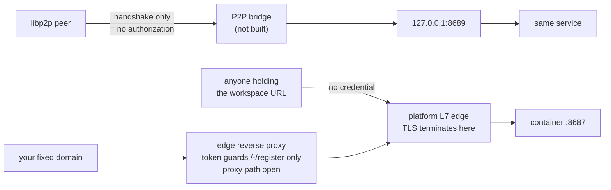
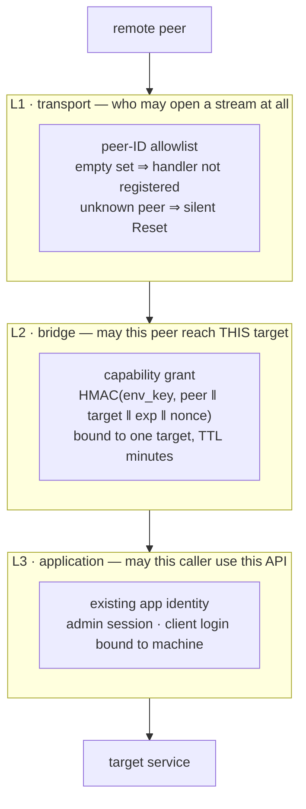

# Ingress Authentication — Design, Not Implementation

> **Status: design document. Nothing in this file is implemented.**
>
> There is no admission control on any bridged ingress today, and the peer-to-peer bridge that
> this document is meant to protect **does not exist yet either** (`BOXPROXY.md` §6). What
> follows is the reasoning that decided the build order: bridge later, authenticate first.

## 0. The problem in one paragraph

Every hosted container in this stack is reachable at a URL whose only access control is the URL
itself. There is no token, no request signature, and no revocation short of rebuilding the
instance — the address **is** the credential. A peer-to-peer bridge whose purpose is to make
that container reachable without the platform's edge would replace "unguessable URL" with "any
peer that completes a handshake". That is strictly weaker, so building the bridge before
solving admission control would ship a second unauthenticated door onto the same service.

## 1. Two doors, one of which you do not control

Three observations that constrain the whole design:

1. **The left door is not ours.** The platform edge terminates TLS, so no credential can be
   injected before it and nothing inside the container can authenticate the requester's *path*.
   Whatever we do inside, `https://<id>-8687.cnb.run` still answers to anyone holding the string.
2. **The bridge would be a second door with weaker locks**, because a libp2p handshake proves
   *possession of a key*, not *permission to reach this service*. Identity is not authorization.
3. **The middle door is ours and is currently open.** `edge` authenticates `/-/register` and
   then proxies everything else unconditionally. That is the cheapest thing to fix and the
   highest-value one, because it is the only door we fully control.

## 2. What the ingress actually is

Measured, not assumed (details in the sibling project's ingress notes):

| Property | Value | Consequence for auth |
|---|---|---|
| Layer | L7 HTTP gateway, not L4 port mapping | no client-cert path, no TCP-level allowlist |
| Edge TLS | terminates at the platform (`*.cnb.run`) | cannot bind identity to a TLS client cert |
| Open ports at edge | 80 / 443 only; 4001 / 7000 / 8686 closed or filtered | no out-of-band control channel |
| Address | `<instance-prefix>-<port>.cnb.run`, prefix random per instance | credentials cannot be pinned to a stable name |
| Rotation | prefix changes on **every rebuild** | free rotation, but also no ACL persistence |
| Binding | must be `0.0.0.0` | the service is reachable from the container network, not just loopback |
| Error surface | a connection failure page shows the container IP | the ingress leaks topology when probed |

The rotation property cuts both ways and is worth stating precisely: a leaked URL expires by
accident on the next rebuild, which is better than a leaked static hostname; but it also means
you can never express "only these callers" as a network rule, because the name the rule would
reference does not survive the night.

## 3. Verified state of authentication in the code

This table is the reason the design is credible — it separates the four places a credential is
already checked from the two places it is not.

| Component | What is checked | Verdict |
|---|---|---|
| `httpapi` (panel) | token if configured; `/health` always open; `?token=` accepted for **reads only**; writes require the `Authorization` header | correct, and the read/write split is the right call |
| `edge` `/-/register` | bearer token; empty token allowed only on loopback because "whoever can rewrite this endpoint redirects all traffic" | correct, fail-closed reasoning |
| `edge` proxy path | **nothing** | open forwarder to whatever upstream is registered |
| `agent` `/terminal`, `/fs`, `/exec` | one shared `AuthToken`, three carry styles: bearer header, `?token=`, and a POST body field | works, but a shared token with a query-string form |
| P2P CDP handler | allowlist of peer IDs; **empty set refuses to register the handler**; unknown peer gets a silent stream `Reset` | the one correct pattern, and it generalises |
| P2P gateway listener | **nothing** — `Accept()` → dial a fixed loopback target → pipe | raw unauthenticated pipe to a loopback port |
| boxproxy | no P2P code at all | bridge not built |

Two design decisions in there are worth promoting to rules rather than leaving as local choices:

**The `?token=` split.** A token in a query string ends up in access logs, browser history,
`Referer` headers and screenshots. Accepting it for reads and refusing it for writes is a
proportionate compromise: a leaked read link exposes data, a leaked write link reboots the box.

**The empty-allowlist refusal.** Refusing to register a handler when the allowlist is empty is
the difference between "not yet configured" and "open to the world". The failure mode of a
missing config must be *no channel*, never *an unguarded channel*.

## 4. Why "loopback means private" stops being true

Today every dangerous service binds `127.0.0.1` and leans on reachability as its authorization.
That assumption is load-bearing in `edge` (proxies to a local upstream), in the P2P listener
(forwards to `127.0.0.1:<business port>`), and in every debugging port on the host.

A bridge's entire purpose is to make a remote peer reach a loopback port. So the bridge converts
*unreachable* into *reachable by anyone who finishes the handshake*, and it does so silently —
the service being reached cannot tell the difference between a local process and a remote peer
that tunnelled in.

This is the security-critical sentence of the document:

> **Any component that turns reachability into a boundary inherits the obligation to replace it.**
> The bridge removes the boundary, so the bridge must supply the missing authorization. Not the
> service behind it — the service cannot see the distinction.

## 5. Design: three independent layers, each fails closed

The layers answer three different questions and none of them substitutes for another:

| Layer | Question | Compromise if absent |
|---|---|---|
| L1 transport | *is this peer known to us?* | one leaked peer key reaches every bridged target |
| L2 bridge | *is this peer allowed to reach this particular target?* | a peer authorised for a dev container reaches production |
| L3 application | *is this caller a legitimate user?* | an authorised peer impersonates any user |

### 5.1 L1 — allowlist, and the two failure modes it must have

Reuse the pattern already proven in the CDP handler: a set, a hard refusal to register when the
set is empty, and a silent stream reset for unknown peers (silence gives a prober no protocol
information and no error detail to work from).

Two operational details that are easy to get wrong:

- **Revocation does not close existing streams.** Removing a peer from the allowlist only affects
  *new* streams. A long-lived pipe stays open forever unless a **maximum stream age** is enforced
  independently. Without that, "revoked" means "revoked at some point in the future".
- **The allowlist must not be the only thing deciding reachability.** What it decides is
  *permission*; whether a *path* exists is a separate question (relay reservation, direct dial).
  Conflating them produces a node that is authorised but unreachable, or reachable and unauthorised.

### 5.2 L2 — per-target capability, not one shared secret

A single shared secret handed to N containers means one compromised container holds a credential
valid against all of them. Grants must be:

- **bound to one target** — a grant for container A's ingress must not open container B's;
- **short-lived** — minutes, because the transport already re-establishes on its own and does not
  need a long-lived application credential;
- **minted per environment, from per-environment keys** — see §6;
- **presented out-of-band** — in a stream preamble or an HTTP header, never in a URL, for the
  same reason the write path refuses `?token=`.

Concretely: `grant = HMAC-SHA256(env_key, peer_id ‖ target_id ‖ expiry ‖ nonce)`, verified by the
bridge before it dials anything. The bridge holds only the verification key; it never holds a
grant that could be replayed elsewhere.

### 5.3 L3 — the bridge must never be the authorizer

The application already has identity: an admin session on one side, a client login bound to a
machine identifier on the other. The rule is that this stays the only source of *user* identity.
The bridge authenticates a *node*, and a node is not a user.

The anti-pattern to name explicitly: **an "internal" flag or a trusted-header injection telling
the app "this request came through the bridge, skip the check."** That converts a transport
compromise into an application compromise, which is exactly the escalation L1/L2 exist to
prevent.

## 6. Trust boundaries across environments

The three platforms have three different ingress shapes and three different credential channels
(access token / OAuth+JWT / cookie). The temptation is to unify them behind one bridge identity.
Do not: unification means the weakest platform sets the security level for all of them.

| Rule | Reason |
|---|---|
| one key per environment | a compromise stays inside the environment it happened in |
| grants never cross environments | a dev grant cannot be replayed against another platform's ingress |
| the bridge's own identity is per-bridge, not per-fleet | limits blast radius of one stolen bridge key |
| platform credentials are never re-exported | a container-side process must not be able to read the token that manages its own lifecycle |

The last row is the one most likely to be violated in practice, because it is convenient: the
process that needs to be restarted is often the process holding the restart credential.

## 7. Classification: what may be bridged at all

The most useful output of this design is not the mechanism, it is the refusal list.

| Endpoint | Bridge it? | Required control |
|---|---|---|
| business API (`:8687` app surface) | yes | L1 + L2 + L3 |
| control panel | yes | L1 + L2 + L3, and it holds write power — treat as admin |
| `/health`, `/-/health` | yes | none, but see §8 |
| `/fs` (file read/write, 64 MiB) | **no** except as part of an authenticated session | fails closed without a caller identity |
| `/terminal` (PTY over WS = a shell) | **no** | equivalent to unauthenticated `ssh`; the bridge adds nothing |
| `/exec` | **no** | same |
| CDP debugging port | **no** unless allowlisted | CDP is total control of a logged-in browser; a wrong resolver default lands on someone else's session |
| anything bound to loopback "because it is loopback" | **no** | that is precisely the assumption the bridge destroys |

Two entries deserve the reasoning spelled out. CDP is not "a debugging interface", it is a
remote control for a browser that is already authenticated to a third-party service — the
existing handler's allowlist exists because of a review finding that an unvalidated stream
handler exposed a browser to the entire libp2p network. `/terminal` is the same argument with a
shell instead of a browser: bridging it is bridging `ssh` without a password.

## 8. What genuinely does not need authentication

Only liveness, and only if it is information-poor.

A probe endpoint has to answer without a credential or it is useless to a load balancer. But
`/health` returning build version, upstream address, peer count and queue depth is
reconnaissance served politely. The rule: **the public unauthenticated path returns a status
code and nothing else**; everything diagnostic moves behind the authenticated path at a different
route.

Note also that an unauthenticated liveness endpoint is not a small hole once it is combined with
the binding requirement — it confirms that a guessed address is live, which promotes a guess into
a target.

## 9. Failure modes — the table that decides the implementation

| Situation | Required behaviour | Why not the alternative |
|---|---|---|
| allowlist empty | refuse to register the handler | "not configured" must not mean "open" |
| grant expired / invalid | close before dialling the target | never dial then check |
| target unresolvable | refuse | a default port silently reaches a different service — the CDP resolver already learned this |
| bridge process cannot start | service stays reachable via the platform path only; record the degradation | silently opening the direct path trades security for uptime without saying so |
| peer revoked mid-stream | existing stream closes at max stream age | otherwise revocation is cosmetic |
| platform address leaked | rotate by rebuilding; never log or return the address | there is no revocation primitive, so rotation is the only remedy |

## 10. What this design does not fix

Stated plainly, because a security document that implies completeness is worse than none:

- **The platform door stays open.** `https://<id>-8687.cnb.run` remains reachable by anyone
  holding the string, whatever the bridge does. Mitigations are limited to not leaking the string
  (logs, error pages, client responses) and letting rebuilds rotate it. The only real fix is to
  never hand out the platform URL — front it with a domain we own, which is what `edge` is for.
- **No mutual TLS between bridge and target.** L2 authenticates the peer at the bridge; the hop
  from bridge to local service is plaintext on loopback.
- **No per-request audit trail.** Grants are per-session, so a log line answers "which peer" but
  not "which grant, issued when, by whom".
- **No rate limiting.** A permitted peer can open streams as fast as the transport allows.
- **Revocation below the max-stream-age floor is not real-time.** Minutes, not seconds.
- **Nothing here is implemented.** No allowlist, no grant minting, no verification, no bridge.

## 11. Implementation order and acceptance criteria

Ordered by value per unit of risk. The first two items are worth doing even if the bridge is
never built, which is the point.

| # | Step | Acceptance |
|---|---|---|
| 1 | Authenticate the `edge` proxy path | an unauthenticated request to the proxied path is rejected; `/-/health` still answers |
| 2 | Fail-closed every listener: empty credential ⇒ refuse to register | starting with no config yields no channel, and says so loudly |
| 3 | Add a peer allowlist to every P2P stream listener, generalised from the CDP handler | unknown peer gets a reset; empty set refuses registration |
| 4 | Enforce max stream age | a revoked peer's open stream closes within the bound |
| 5 | Mint and verify per-target grants (§5.2) | a grant for target A is rejected by target B; an expired grant is rejected before dialling |
| 6 | Per-environment keys (§6) | a key from one environment cannot verify a grant from another |
| 7 | **Only then** build the bridge | bridging a container ingress requires steps 1–6 to pass |

## 12. Open questions

1. **Where does the grant live between sessions?** Minting per connection is cheapest but adds a
   round trip on every re-establish; caching needs its own expiry discipline.
2. **Should `edge` authenticate with the same mechanism as the bridge, or its own?** Unifying is
   simpler; separating keeps a compromise of one from unlocking the other.
3. **Does the panel need its own identity or can it reuse the admin session?** Reusing avoids a
   second credential to rotate; separating means a stolen panel token is not an admin session.
4. **Can the platform URL be made unguessable enough to skip fronting?** The prefix is random per
   instance, which is better than a static name — but it appears in logs, browser history, and any
   error page, so the answer is no for anything that matters.
