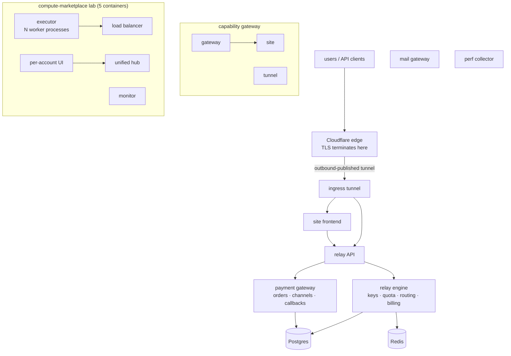

# OPERATIONS — What Actually Ran, and For How Long

> **Status: measured.** Every number below was read off the running system or off a public
> chain at the timestamp stated. Where a figure comes from the operator's own dashboard rather
> than an independently reproducible source, it is labelled `operator-reported` and is not used
> to support a claim on its own.

A design document can describe intent. This file is the other half: the record of a single
consumer-grade host that has been running a commercial service stack continuously for over two
months, plus one agent that settled payments on a public chain for two months before it was
stopped on purpose.

The point is not that the numbers are large. The point is that they are **checkable**.

## 0. Methodology, because it decides what the numbers are worth

| Source | How obtained | Confidence |
|---|---|---|
| Host uptime, load, memory, disk | `uptime`, `free -h`, `df -h`, `nproc` over SSH | measured |
| Container inventory, creation time, restart count | `docker inspect` per container | measured |
| Per-container memory and CPU | `docker stats --no-stream` | measured |
| Image and volume footprint | `docker system df` | measured |
| Web endpoint liveness | `curl -o /dev/null -w '%{http_code}'` | measured |
| Chain identity, tx count, balance | JSON-RPC `eth_chainId` / `eth_getTransactionCount` / `eth_getBalance` / `eth_getCode` | measured |
| Settlement window, advertised model count, revenue, fees | operator dashboard | **operator-reported** |

Two deliberate omissions, both because they would have been guesses dressed as data:

- **No weekly on-chain activity curve.** `eth_getTransactionCount` at a historical block requires
  archive state, and the public RPC returns *latest* instead of an error, which silently produces
  a flat line that looks like real data. Reconstruction would need an archive endpoint.
- **No revenue-per-model split.** The dashboard aggregates it; inventing a breakdown would be
  fabrication.

## 1. The host

A machine on home broadband, not a datacenter. It is the entry point for everything below.

```
uptime          66 days (no reboot since deployment began)
CPU             16 cores, load average 0.86 / 1.10 / 1.10
RAM             14 GiB total, 9.3 GiB available
Disk            35 GiB used of 40 GiB  (93%)
Network         residential uplink, no public IPv4, IPv6 present
Ingress         Cloudflare Tunnel (outbound only, no port forwarding required)
```

The last two lines are the interesting part and the reason the stack looks the way it does: with
no inbound port and a rotating address, every service has to be reachable through an outbound
tunnel or not at all. That is a design constraint, not a shortcut — the same constraint that
produced the per-environment ingress analysis in [`BOXPROXY.md`](BOXPROXY.md).

## 2. Topology

Sixteen containers, five functional groups, one host.



| Group | Containers | Role |
|---|---|---|
| Relay station | relay engine, site frontend, ingress tunnel, perf collector | OpenAI-compatible API sold to end users: keys, quota, routing, billing |
| Payments | payment gateway | order lifecycle, channel adapters, callbacks |
| Capability gateway | gateway, site, tunnel | the system described in `ARCHITECTURE.md` |
| Marketplace lab | executor, load balancer, portal, hub, monitor | multi-account worker orchestration |
| Data / mail | Postgres, Redis, mail gateway | state, cache, transactional mail |

Two structural decisions worth naming, because they are the difference between "16 containers"
and "a system":

- **The relay engine, not the frontend, owns quota and billing.** The front end is replaceable;
  the accounting ledger is not. Every request that spends a user's balance passes through one
  component, which is why the payment gateway and the engine share Postgres rather than talking
  to each other over HTTP.
- **The lab isolates per-account state in a directory, not in the orchestrator.** Adding an
  account is a directory plus a key, picked up by a rescan loop within 15 s. Nothing restarts,
  nothing is re-scheduled, and the orchestrator holds no state that a backup would have to
  reconstruct.

## 3. Deployment timeline, reconstructed from container creation times

Not a plan — the actual order things were brought up, read from `docker inspect`.

| Date | Deployed | Group |
|---|---|---|
| 2026-09-14 | Postgres, Redis | data |
| 2026-09-15 | portal, hub | lab |
| 2026-09-16 | mail gateway | mail |
| 2026-09-18 | ingress tunnel | relay station |
| 2026-09-19 | executor, payment gateway | lab, payments |
| 2026-09-21 | perf collector | relay station |
| 2026-09-23 | monitor | lab |
| 2026-09-24 | load balancer | lab |
| 2026-09-26 | relay engine | relay station |
| 2026-10-23 | site frontend | relay station |
| 2026-11-01 → 11-04 | capability gateway, site, tunnel | capability gateway |

Two things this table shows that a summary would hide:

**Data stores came first, the money path came fifth.** Postgres and Redis were up five days
before the payment gateway. That ordering is what makes the payment integration testable —
there was already a schema to write against.

**The stack was staged over seven weeks, not deployed at once.** The gap between the relay engine
(09-26) and its front end (10-23) is four weeks: the API was serving before the site existed.
That is a deliberate "backend first, sell surface second" order, and the deployment record proves
it happened rather than asserting it was intended.

## 4. Stability evidence

The claim "it has been up for two months" is worth exactly nothing without a failure counter.
Here is the counter.

| Container | Created | Restart count | Current run started |
|---|---|---|---|
| postgres | 09-14 | **0** | 09-15 |
| redis | 09-14 | **0** | 09-15 |
| portal | 09-15 | **0** | 09-15 |
| hub | 09-15 | **0** | 09-15 |
| mail gateway | 09-16 | **0** | 09-16 |
| ingress tunnel | 09-18 | **0** | 10-26 |
| executor | 09-19 | **0** | 09-19 |
| payment gateway | 09-19 | **0** | 09-19 |
| perf collector | 09-21 | **0** | 09-21 |
| monitor | 09-23 | **0** | 09-23 |
| load balancer | 09-24 | **0** | 09-24 |
| relay engine | 09-26 | **0** | 09-26 |
| site frontend | 10-23 | **0** | 10-23 |
| capability gateway | 11-04 | **0** | 11-04 |
| capability site | 11-02 | **0** | 11-02 |
| capability tunnel | 11-01 | **0** | 11-01 |

**Zero restarts across all sixteen containers, including the ones that have been up longest.**
Restart policy is `unless-stopped` on thirteen, `always` on two, `no` on one — so a crash would
have been auto-restarted and *counted*. The counter is zero because nothing crashed, not because
nothing was watching.

The two rows where "created" and "started" differ are honest exceptions, not anomalies: Postgres
and Redis were stopped and started the day after creation while the schema was being settled, and
the ingress tunnel ran from 09-18, was stopped, and was brought back on 10-26 when the front end
was ready to be published. Both were intentional.

Resource consumption at the time of recording:

| Container | Memory | CPU |
|---|---|---|
| executor | 2.22 GiB | 23.4% |
| perf collector | 220 MiB | 0.0% |
| per-account UI | 188 MiB | 0.0% |
| monitor | 87 MiB | 0.0% |
| capability gateway | 84 MiB | 0.9% |
| payment gateway | 72 MiB | 0.6% |

One container accounts for 95% of the memory in use; the rest are small. That distribution is
the reason the host fits in 14 GiB at all — and the reason the executor is the only thing whose
scaling is a real capacity question.

## 5. The web3 leg: an agent that settled on a public chain

Separate from the host above, one agent operated on **Base mainnet** (`chainId 8453`, verified by
`eth_chainId` returning `0x2105`).

Independently verified from a public RPC:

| Property | Value | How |
|---|---|---|
| Address type | EOA | `eth_getCode` → `0x` |
| Transactions sent | **2,061** | `eth_getTransactionCount` |
| Balance at recording | **0.000003 ETH** | `eth_getBalance` |
| Agent id | 59617 | matches the local account state file |
| Address | `0xbc33…b75f` | truncated here, full value available on request |

Operator-reported, not independently reproducible without the settlement contract's logs:

| Property | Value |
|---|---|
| Models advertised | 14 |
| First settlement | 2026-07-27 |
| Last settlement | 2026-09-24 |
| Revenue | $114.25 |
| Platform fees | $4.57 |
| Free-tier serving before first settlement | until 2026-07-27 |

### 5.1 Why it stopped, and why that is the interesting part

The wallet holds **0.000003 ETH**. It did not run out of demand, capacity, or uptime — it ran out
of the token needed to submit transactions. Revenue over the settlement window was $114.25 against
$4.57 in platform fees, and the cost of keeping the wallet funded exceeded what the remaining
margin justified.

So the correct action was to stop settling while leaving the service running, which is exactly
what happened: **last settlement 2026-09-24, containers still up.** Earning and running were
decoupled on purpose.

For a node-operations role this is the substance worth reading, more than the revenue figure:

- The distinction between **a service being available** and **a service being economical** is the
  daily decision in node operation, and most people only instrument the first.
- Stopping is a *state transition with a rollback path*, not a shutdown. The identity keys, the
  channel state, and the config all survive; funding the wallet resumes settlement with no
  re-registration. That is why the containers were left running.
- The revenue is small. Reporting it as small is the point: an operator who inflates $114 into a
  headline is an operator whose larger numbers cannot be trusted either.

### 5.2 What this does and does not prove

It proves: real participation in a token-incentivised network, real key and channel management,
real settlement, and a cost-driven decision to pause.

It does **not** prove: running a chain client, participating in consensus, or operating a
validator. There is no `op-geth`/`op-node` here, no sync mode, no attestation, no slashing
exposure. Those are different skills with different failure modes, and claiming this record
covers them would be the kind of inflation §5.1 just argued against.

The honest boundary: **this is marketplace-side node operation, not protocol-side node
operation.** They share key management, settlement accounting, and uptime discipline; they do not
share the client.

## 6. What the host cannot do, and the one thing that will break first

Recorded because a capacity limit discovered during an incident is worth less than one written
down beforehand.

| Limit | Value | Consequence |
|---|---|---|
| Disk | 40 GiB, **93% used** | the binding constraint; see below |
| RAM | 14 GiB, 9.3 GiB free | comfortable until the executor scales |
| Public IPv4 | none | every ingress must be an outbound tunnel |
| Address stability | none (residential) | cannot host a protocol-level relay |
| Full chain node | **not possible** | a Base/Ethereum full node needs 10²–10³ GiB |

### 6.1 The disk finding

Measured, not estimated:

```
filesystem         total   used   avail  use%
/                  40 GiB  35 GiB  5 GiB  93%

docker system df:
  Images          100 total, 15 active   16.3 GB   (5.55 GB reclaimable, 34%)
  Containers       16 active            257.5 MB
  Volumes           7 total, 5 active   135.4 MB

du:  /var   22 GiB      /usr  9.1 GiB
     /var/log        4.0 GiB
     /var/lib/docker/containers  1.5 GiB
```

Roughly 5.55 GB is reclaimable from unused images alone, and 4 GB is in `/var/log`. Pruning both
takes the host from 93% to roughly 63%.

Why this is reported rather than quietly fixed: **a host running Postgres at 93% is not a
performance problem, it is a scheduled outage.** The failure does not look like "disk full" — it
looks like the database refusing writes while the API keeps returning 500s, and then `docker pull`
failing during the recovery attempt because there is no room to stage the image. Writing the
number down before it bites is the whole discipline.

## 7. Reproduction

Every measured claim in this file can be re-derived with the commands below.

```bash
# host
ssh <host> 'uptime; nproc; free -h; df -h /'

# container inventory and stability
ssh <host> 'docker ps -a --format "{{.Names}}" | while read n; do
  docker inspect "$n" --format "{{.Name}}|{{.Created}}|{{.RestartCount}}|{{.State.StartedAt}}"
done'

# resource distribution
ssh <host> 'docker stats --no-stream --format "{{.Name}}\t{{.MemUsage}}\t{{.CPUPerc}}"'
ssh <host> 'docker system df'

# endpoint liveness (401 on the API is the healthy answer — it means auth is enforced)
curl -s -o /dev/null -w '%{http_code} %{time_total}\n' https://<site>/
curl -s -o /dev/null -w '%{http_code} %{time_total}\n' https://<api>/v1/models

# chain facts, no API key needed, any Base mainnet RPC
curl -s -X POST https://base-rpc.publicnode.com -H 'Content-Type: application/json' \
  -d '{"jsonrpc":"2.0","id":1,"method":"eth_chainId","params":[]}'
curl -s -X POST https://base-rpc.publicnode.com -H 'Content-Type: application/json' \
  -d '{"jsonrpc":"2.0","id":1,"method":"eth_getTransactionCount","params":["<address>","latest"]}'
```

Note on the last two: a historical block argument requires archive state. Public endpoints may
return the latest value instead of an error, which produces a plausible-looking but false
time series. Recorded here because it cost an hour and would cost the next reader the same.

## 8. What is deliberately not in this file

- The public domain name and the tunnel hostnames. The operational record stands on its own; tying
  a job application to a live commercial relay is a decision for its owner, not a side effect of
  publishing.
- The full wallet address, in this version. Truncated above.
- Credentials, keys, channel state, ports, and internal addressing.
- Per-model revenue, because the dashboard does not provide it and estimating it would be the
  exact failure mode §0 exists to prevent.
